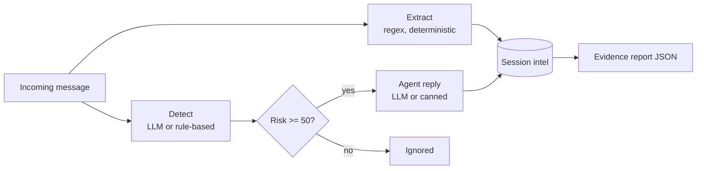

# 🛡️ Agentic Honey-Pot

A defensive prototype that detects scam messages (bank-block, OTP theft, KYC,
lottery, delivery-fee), replies in character as a cautious "victim" to keep the
sender talking, and collects reportable evidence: UPI IDs, phone numbers, bank
accounts, IFSC codes and phishing links.

> **Status:** research prototype. The original single-turn, keyword-based
> version predates the Meta Global AI Developer Hackathon. This version adds
> Meta Model API (Muse Spark) integration, multi-turn sessions, and reports.

## How it works



- **Detection and replies:** Meta Model API (`muse-spark-1.1` by default).
  If no key is set or a call fails, it falls back to a rule-based mode and
  says so in the UI footer.
- **Extraction:** pure regex, so results are reproducible and never invented
  by a model.
- **Sessions:** in-memory (lost on restart). Risk never drops mid-conversation.
- **Languages:** English prompts; Hindi and Tamil keywords in the fallback
  detector; the LLM is told to reply in the sender's language.

## Run locally

```bash
python -m venv .venv && .venv\Scripts\activate      # Windows
pip install -r requirements.txt
copy .env.example .env                                # then add your key
uvicorn main:app --reload
```
Open http://127.0.0.1:8000. Without a key it runs in rule-based demo mode.

## API

`POST /honeypot` with header `x-api-key` and body
`{"message": "...", "session_id": "optional"}` returns detection, the agent
reply, and extracted intelligence. `GET /api/report/{session_id}` downloads the
evidence report.

## Tests

```bash
pip install -r requirements-dev.txt
pytest
```

## Limitations (honest list)

- The rule-based scorer is a heuristic, not a trained classifier.
- Sessions are in memory, with simple per-IP rate limiting.
- LLM output can be wrong; extraction is regex-only and can miss formats.
- Links are never opened or visited.
- Use only synthetic or sample messages: free-credit usage may be used by the
  provider for product improvement.
- Reports are for review, not automatic filing.

## Roadmap
Persistent storage, Tamil/Hindi prompt tuning and evaluation, a labelled test
set with measured accuracy.

## License
MIT
